# Sistema de Detección Predictiva de Fraude en Transacciones Electrónicas

### Proyecto Final | Machine Learning y Simulación de Reglas de Riesgo

**Área de estudio:** Ciencia de Datos, Inteligencia de Negocios y Gestión de Riesgos

**Tecnologías:** Python, Jupyter Notebook, Pandas, NumPy, Scikit-learn, Matplotlib y Seaborn.

**Proyecto antecedente:** [Proyecto Fraude Midterm](https://github.com/wilydus-png/Proyecto-Fraude-Midterm)

---

## 1. Descripción del proyecto

Este proyecto constituye la segunda fase del trabajo desarrollado durante el Midterm, orientado al análisis de patrones transaccionales y al diseño de reglas tradicionales para la detección de fraude en pagos electrónicos.

En esta nueva etapa se implementan técnicas de Machine Learning para entrenar modelos capaces de clasificar transacciones como legítimas o fraudulentas.

Se desarrollaron tres modelos predictivos:

- Regresión Logística.
- Árbol de Decisión.
- Random Forest.

Posteriormente, se compararon con las tres reglas tradicionales R1, R2 y R3 diseñadas durante el Midterm.

Adicionalmente, se realizaron simulaciones de umbrales de riesgo, capacidad de revisión de alertas, estrategias híbridas y escenarios económicos.

El propósito es evaluar no solamente la capacidad de identificar fraudes, sino también la eficiencia operativa y las implicaciones económicas de las estrategias de detección.

---

## 2. Objetivos

### 2.1. Objetivo general

Desarrollar y evaluar modelos predictivos para la detección de fraude en transacciones electrónicas mediante técnicas de Machine Learning, comparando su desempeño con reglas tradicionales y analizando su comportamiento operativo y económico.

### 2.2. Objetivos específicos

1. Preparar los datos transaccionales para el entrenamiento de modelos predictivos.

2. Implementar algoritmos supervisados de clasificación mediante Regresión Logística, Árbol de Decisión y Random Forest.

3. Evaluar el desempeño de los modelos utilizando Precision, Recall, F1-Score y matrices de confusión.

4. Comparar los resultados de Machine Learning con las reglas tradicionales de detección de fraude desarrolladas durante el Midterm.

5. Simular diferentes umbrales de clasificación y capacidades de revisión de alertas.

6. Evaluar estrategias híbridas que combinen reglas tradicionales con modelos predictivos.

7. Analizar el impacto operativo y económico de las estrategias mediante escenarios hipotéticos.

---

## 3. Fuente de datos

Se utilizó el conjunto de datos Credit Card Transactions Fraud Detection, disponible en Kaggle.

Los archivos originales utilizados fueron:

- `fraudTrain.csv`
- `fraudTest.csv`

La base contiene 1.852.394 transacciones electrónicas.

| Conjunto | Transacciones | Fraudes |
|---|---:|---:|
| Entrenamiento original | 1.296.675 | 7.506 |
| Prueba original | 555.719 | 2.145 |
| **Total** | **1.852.394** | **9.651** |

La variable objetivo es `is_fraud`:

- `0`: Transacción legítima.
- `1`: Transacción fraudulenta.

### 3.1. Desbalance de clases

Los datos presentan un marcado desbalance entre las transacciones legítimas y fraudulentas.

En el conjunto original de entrenamiento, los fraudes representan el 0,579 %, mientras que en el conjunto de prueba representan el 0,386 %.

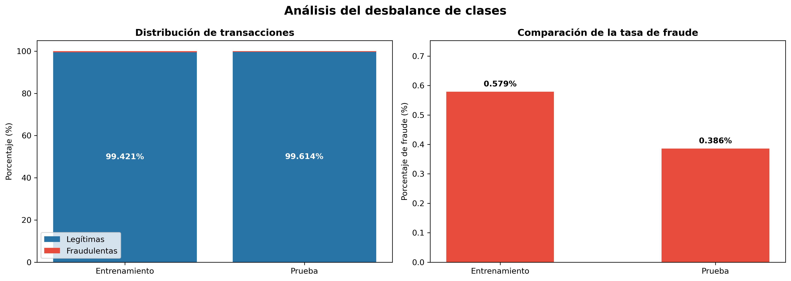

Esta característica justifica la utilización de métricas especializadas, debido a que Accuracy puede producir resultados engañosos cuando la clase fraudulenta es minoritaria.

---

## 4. Metodología

El proyecto se desarrolló siguiendo una metodología estructurada de preparación, entrenamiento, evaluación y simulación.

### 4.1. Preparación de datos

Se realizaron las siguientes actividades:

- Carga y verificación de los archivos originales.
- Identificación de las variables disponibles.
- Revisión de valores nulos.
- Transformación de características temporales.
- Cálculo de características geográficas.
- Selección de variables predictivas.
- Codificación de variables categóricas.
- Estandarización de variables numéricas.

### 4.2. Ingeniería de características

Se utilizaron ocho variables predictivas:

| Variable | Descripción |
|---|---|
| amt | Monto de la transacción |
| category | Categoría comercial |
| merchant | Comercio de la transacción |
| hora | Hora de la operación |
| dia_semana | Día de la semana |
| fin_semana | Indicador de fin de semana |
| distancia_km | Distancia geográfica calculada |
| city_pop | Población de la ciudad |

La variable `distancia_km` se calculó mediante la fórmula de Haversine, utilizando las coordenadas asociadas al cliente y al comercio.

Esta distancia no representa necesariamente el desplazamiento real del titular durante la transacción.

Para el preprocesamiento se utilizaron StandardScaler, OneHotEncoder y ColumnTransformer de Scikit-learn.

### 4.3. División cronológica de datos

Se trabajó con tres conjuntos:

| Conjunto | Transacciones | Fraudes |
|---|---:|---:|
| Entrenamiento | 1.037.340 | 5.968 |
| Validación | 259.335 | 1.538 |
| Prueba | 555.719 | 2.145 |

La división cronológica permitió entrenar con transacciones anteriores y evaluar el desempeño sobre periodos posteriores.

El conjunto de prueba se mantuvo independiente durante el entrenamiento y la selección de umbrales.

---

## 5. Modelos predictivos

Se desarrollaron tres algoritmos de clasificación supervisada.

### 5.1. Regresión Logística

La Regresión Logística se utilizó como modelo inicial de referencia.

Se incorporó ponderación de clases mediante `class_weight="balanced"` para considerar el desbalance entre operaciones legítimas y fraudulentas.

El modelo permitió obtener puntuaciones de riesgo y analizar cómo diferentes umbrales modifican la capacidad de detección.

### Matriz de confusión

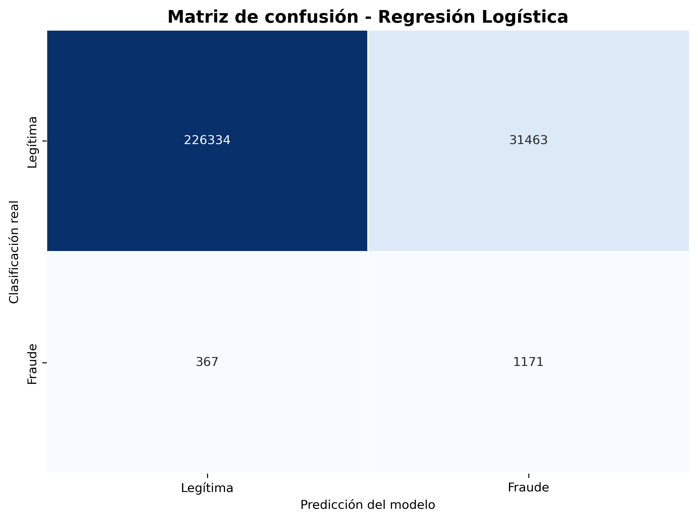

En el conjunto de validación, utilizando un umbral de 0,50, el modelo identificó 1.171 fraudes y generó 31.463 falsas alertas.

### Simulación de umbrales

Se evaluaron diferentes umbrales de clasificación para estudiar la relación entre Precision, Recall y falsas alertas.

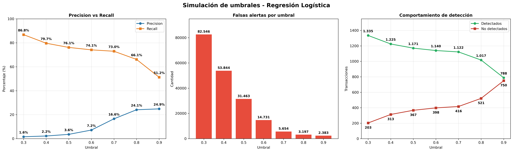

La simulación demostró que aumentar el umbral permite disminuir las falsas alertas, aunque también puede reducir la cantidad de fraudes identificados.

### 5.2. Árbol de Decisión

Se entrenó un modelo DecisionTreeClassifier con restricciones de profundidad y tamaño mínimo de hoja para controlar su complejidad.

Configuración inicial:

- `max_depth=10`
- `min_samples_leaf=50`
- `class_weight="balanced"`
- `random_state=42`

El modelo alcanzó una profundidad de 10 niveles y generó 179 hojas.

### Comparación con Regresión Logística

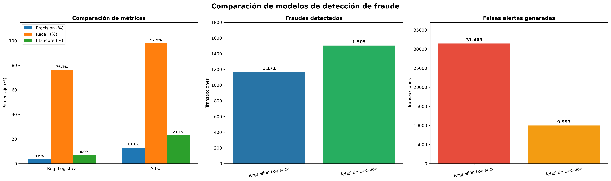

En la evaluación inicial de validación, el Árbol de Decisión consiguió detectar más fraudes y generar menos falsas alertas que la Regresión Logística con umbral 0,50.

### 5.3. Random Forest

Se implementó RandomForestClassifier con 50 árboles de decisión.

Configuración inicial:

- `n_estimators=50`
- `max_depth=12`
- `min_samples_leaf=50`
- `class_weight="balanced_subsample"`
- `n_jobs=2`
- `random_state=42`

El modelo permitió evaluar una estrategia de priorización de transacciones según sus puntuaciones de riesgo.

### Comparación integral de modelos

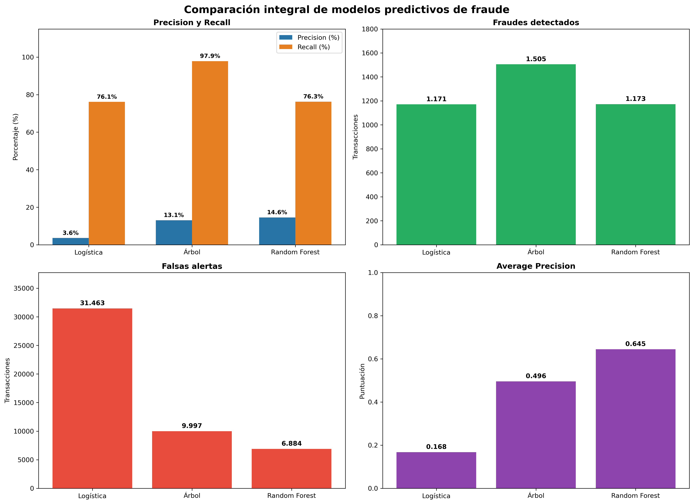

Random Forest obtuvo el mayor Average Precision en validación, con un valor aproximado de 0,645.

El Árbol de Decisión obtuvo la mayor capacidad de detección con umbral 0,50.

---

## 6. Simulación de umbrales de riesgo

Se desarrollaron simulaciones para analizar cómo cambia el comportamiento de los modelos cuando se modifica el umbral utilizado para generar alertas.

Para Árbol de Decisión y Random Forest se evaluaron umbrales comprendidos entre 0,10 y 0,90.

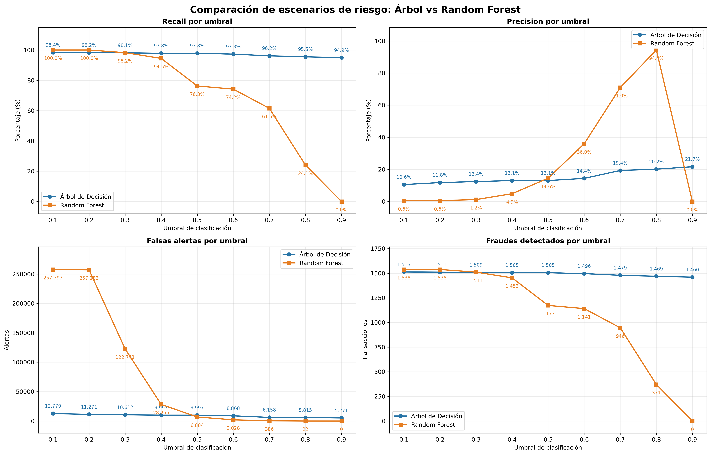

Los resultados evidenciaron que el Árbol de Decisión mantiene un Recall elevado incluso con umbrales altos.

Por otra parte, Random Forest permite alcanzar niveles superiores de precisión cuando se priorizan únicamente las transacciones con puntuaciones de riesgo más elevadas.

Las puntuaciones de riesgo no fueron calibradas como probabilidades reales de fraude.

---

## 7. Simulación de capacidad operativa Top-K

Se implementó una simulación Top-K para comparar los modelos bajo una misma capacidad de revisión.

Se evaluaron capacidades hipotéticas de:

- 1.000 alertas.
- 3.000 alertas.
- 5.000 alertas.
- 10.000 alertas.

Para cada escenario se seleccionaron las transacciones con mayores puntuaciones de riesgo.

### Resultados principales

| Capacidad | Mejor modelo | Fraudes detectados | Recall |
|---|---|---:|---:|
| 1.000 | Random Forest | 820 | 53,32 % |
| 3.000 | Random Forest | 1.134 | 73,73 % |
| 5.000 | Árbol de Decisión | 1.294 | 84,14 % |
| 10.000 | Árbol de Decisión | 1.494 | 97,14 % |

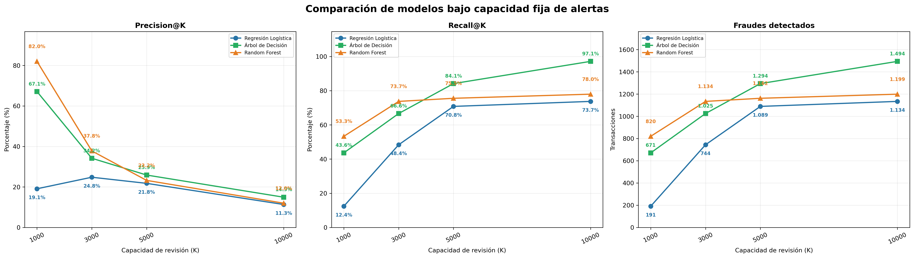

Los resultados demostraron que la selección del modelo depende de la capacidad disponible para revisar alertas.

Random Forest destacó con capacidades reducidas, mientras que el Árbol de Decisión obtuvo mejores resultados cuando se amplió el volumen de revisión.

Los resultados corresponden a una simulación retrospectiva sobre el conjunto de validación.

---

## 8. Comparación con reglas tradicionales

Se incorporaron las reglas del proyecto Midterm para compararlas con los modelos predictivos.

### Reglas evaluadas

| Regla | Condiciones |
|---|---|
| R1 | Monto mayor o igual a USD 200 |
| R2 | Monto mayor o igual a USD 200 y horario entre 22:00 y 03:59 |
| R3 | Condiciones de R2 y categorías comerciales seleccionadas |

Las categorías utilizadas en la implementación de R3 fueron:

- shopping_net
- misc_net
- grocery_pos

### Comparación de seis estrategias

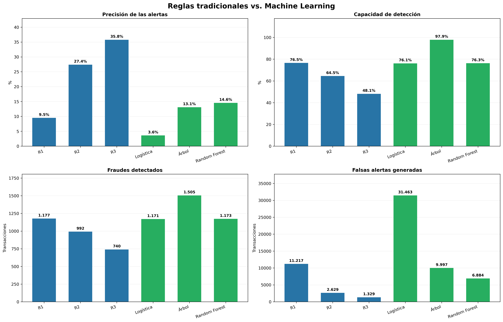

El análisis demostró que las reglas tradicionales pueden presentar niveles importantes de precisión, pero también pueden dejar sin detectar una proporción considerable de fraudes.

Por otro lado, los modelos predictivos permiten identificar patrones adicionales y generar puntuaciones de riesgo para priorizar operaciones.

---

## 9. Estrategia híbrida

Se evaluó una estrategia que combina la regla R3 con Random Forest.

La estrategia consistió en priorizar las transacciones que activaban R3 y completar una capacidad hipotética de 5.000 alertas con las transacciones de mayor riesgo identificadas por Random Forest.

### Resultados

| Estrategia | Fraudes detectados | Precision@5000 |
|---|---:|---:|
| Árbol de Decisión | 1.294 | 25,88 % |
| Random Forest | 1.162 | 23,24 % |
| Híbrido R3 + Random Forest | 1.158 | 23,16 % |
| Regresión Logística | 1.089 | 21,78 % |

La estrategia híbrida no superó el desempeño de Random Forest individual ni del Árbol de Decisión bajo la capacidad de revisión considerada.

Este resultado evidencia que combinar reglas y modelos predictivos no garantiza automáticamente una mejora.

---

## 10. Evaluación final sobre el conjunto de prueba

La evaluación final utilizó 555.719 transacciones, de las cuales 2.145 correspondían a fraudes reales.

Los umbrales seleccionados previamente fueron:

- Regresión Logística: 0,80.
- Árbol de Decisión: 0,90.
- Random Forest: 0,70.

### Resultados finales

| Estrategia | Alertas | Fraudes detectados | Falsos positivos | Precision | Recall | F1-Score |
|---|---:|---:|---:|---:|---:|---:|
| R1 | 25.353 | 1.611 | 23.742 | 6,35 % | 75,10 % | 11,72 % |
| R2 | 7.035 | 1.363 | 5.672 | 19,37 % | 63,54 % | 29,69 % |
| R3 | 3.898 | 1.069 | 2.829 | 27,42 % | 49,84 % | 35,38 % |
| Regresión Logística | 8.252 | 1.395 | 6.857 | 16,90 % | 65,03 % | 26,83 % |
| Árbol de Decisión | 13.254 | 2.001 | 11.253 | 15,10 % | 93,29 % | 25,99 % |
| Random Forest | 2.077 | 1.275 | 802 | 61,39 % | 59,44 % | 60,40 % |

### Principales hallazgos

**Árbol de Decisión:** obtuvo la mayor capacidad de detección, identificando 2.001 de los 2.145 fraudes reales.

**Random Forest:** obtuvo la mayor precisión, identificando 1.275 fraudes reales entre 2.077 alertas generadas.

### Comparación de estabilidad entre validación y prueba

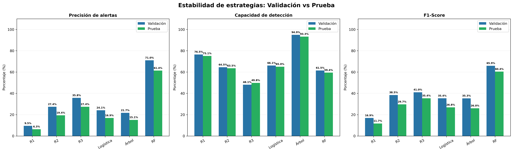

Los resultados mostraron variaciones moderadas en Recall y disminuciones en Precision entre ambos conjuntos.

Parte de estas diferencias puede relacionarse con el cambio en la proporción de fraude entre los periodos analizados.

---

## 11. Análisis de eficiencia operativa

Se evaluó la carga de revisión generada por cada estrategia.

Se calcularon tres indicadores:

1. Alertas por fraude detectado.
2. Alertas por cada 1.000 transacciones.
3. Falsas alertas por fraude detectado.

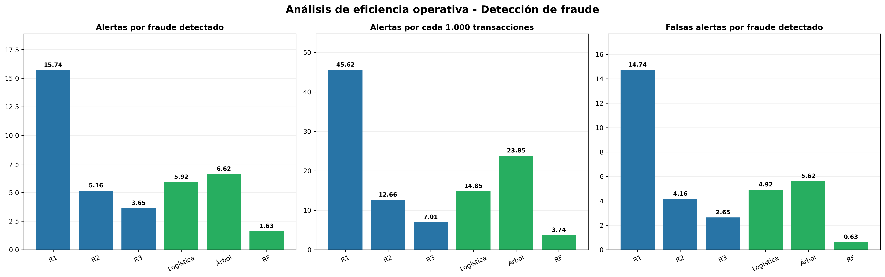

Random Forest presentó aproximadamente 1,63 alertas por fraude detectado.

El Árbol de Decisión presentó una carga superior, pero también identificó una proporción considerablemente mayor de fraudes.

Los resultados evidencian la necesidad de considerar simultáneamente capacidad de detección y recursos disponibles para revisar alertas.

---

## 12. Simulación económica

Se desarrolló una estimación económica simplificada considerando dos componentes:

1. Costo de revisión de alertas.
2. Pérdida hipotética por fraude no detectado.

La fórmula utilizada fue:

**Costo total = (Alertas × Costo por revisión) + (Fraudes no detectados × Pérdida promedio por fraude)**

### Supuestos económicos

- Costo por revisión: USD 2.
- Pérdida por fraude no detectado: USD 100.

### Resultados

| Estrategia | Costo total hipotético |
|---|---:|
| Árbol de Decisión | USD 40.908 |
| Random Forest | USD 91.154 |
| Regresión Logística | USD 91.504 |
| R2 | USD 92.270 |
| R1 | USD 104.106 |
| R3 | USD 115.396 |

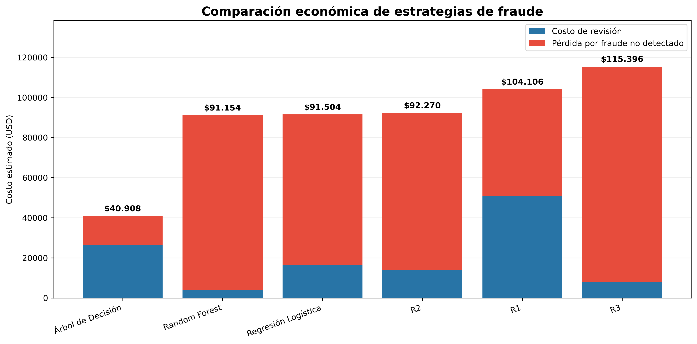

Bajo los supuestos establecidos, el Árbol de Decisión obtuvo el menor costo estimado debido a su mayor capacidad de detección.

Estos valores no representan pérdidas ni ahorros reales de una entidad financiera.

---

## 13. Análisis de sensibilidad económica

Se evaluaron 25 escenarios económicos, combinando cinco costos de revisión y cinco pérdidas hipotéticas por fraude.

### Costos de revisión

USD 1, 2, 5, 10 y 20.

### Pérdidas por fraude no detectado

USD 25, 50, 100, 250 y 500.

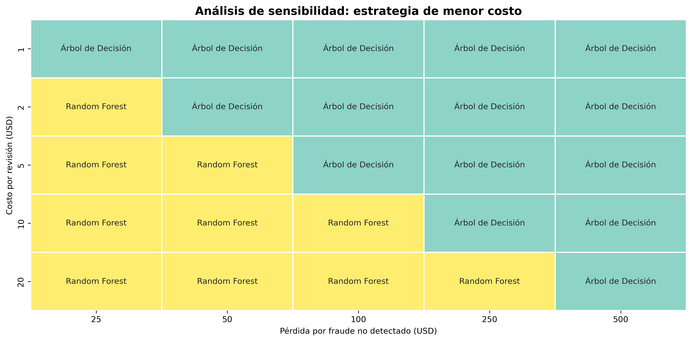

### Resultados

- Árbol de Decisión presentó el menor costo en 15 escenarios.
- Random Forest presentó el menor costo en 10 escenarios.

Los resultados indican que la estrategia económicamente más conveniente depende de la relación entre el costo de revisión y la pérdida potencial por fraude.

Cuando la pérdida por fraude es elevada respecto al costo de revisión, el Árbol de Decisión suele presentar ventajas.

Cuando la revisión resulta relativamente costosa, Random Forest puede convertirse en una alternativa más eficiente.

---

## 14. Conclusiones

1. El proyecto permitió desarrollar y evaluar tres modelos predictivos de fraude y compararlos con tres reglas tradicionales.

2. El Árbol de Decisión presentó la mayor capacidad de detección en el conjunto de prueba, con un Recall del 93,29 %.

3. Random Forest obtuvo la mayor precisión de las estrategias finales, alcanzando el 61,39 %.

4. Las reglas tradicionales mantuvieron utilidad como mecanismos de clasificación, aunque mostraron limitaciones en el equilibrio entre precisión y cobertura.

5. Las simulaciones Top-K demostraron que el modelo más conveniente depende de la capacidad operativa disponible.

6. La estrategia híbrida R3 + Random Forest no mejoró los resultados en el escenario de 5.000 alertas evaluado.

7. El análisis económico evidenció que la selección de una estrategia debe considerar los costos de revisión y las pérdidas potenciales por fraude no detectado.

8. Los resultados indican que las técnicas de Machine Learning pueden complementar los enfoques tradicionales, pero no existe un único modelo superior para todas las condiciones.

---

## 15. Recomendaciones

- Considerar el Árbol de Decisión como alternativa experimental cuando el objetivo prioritario sea maximizar la detección de fraudes.

- Considerar Random Forest cuando se requiera priorizar transacciones de mayor riesgo y reducir el volumen de alertas.

- Utilizar Precision, Recall, F1-Score y métricas operativas para evaluar los sistemas de detección, evitando depender únicamente de Accuracy.

- Incorporar costos reales de revisión, pérdida por fraude, recuperación y capacidad de analistas en futuros estudios.

- Evaluar periódicamente los modelos con información transaccional más reciente.

- Analizar mecanismos de calibración de puntuaciones de riesgo.

- Mantener controles tradicionales como mecanismos complementarios, sujetos a evaluaciones de efectividad.

---

## 16. Limitaciones del estudio

El conjunto de datos utilizado es histórico y no representa necesariamente las condiciones actuales de una entidad financiera.

Los modelos fueron desarrollados utilizando un conjunto limitado de variables y no incluyen información completa sobre dispositivos, autenticación, comportamiento dinámico del cliente o mecanismos operativos de autorización.

Las reglas tradicionales del Midterm se construyeron a partir de un análisis exploratorio que incluyó información posteriormente utilizada en las evaluaciones. Por ello, su comparación debe considerarse retrospectiva.

Las puntuaciones generadas por los modelos con ponderación de clases no fueron calibradas como probabilidades reales de fraude.

Los análisis Top-K y las simulaciones de reglas no representan la operación de un sistema transaccional en tiempo real.

El análisis económico utiliza costos hipotéticos y supone que los fraudes identificados pueden gestionarse eficazmente. No incorpora todos los costos, recuperaciones ni efectos sobre los clientes.

Antes de una implementación real sería necesario efectuar validaciones adicionales, pruebas prospectivas, evaluaciones de seguridad, privacidad y supervisión operativa.

---

## 17. Herramientas utilizadas

| Herramienta | Aplicación |
|---|---|
| Python 3.13 | Programación |
| Jupyter Notebook | Desarrollo del proyecto |
| Pandas | Manipulación de datos |
| NumPy | Cálculos numéricos |
| Scikit-learn | Machine Learning |
| Matplotlib | Visualización |
| Seaborn | Gráficos estadísticos |
| GitHub | Documentación y publicación |

---

## 18. Estructura del proyecto

```text
Proyecto-Fraude-Modelamiento/
|
|-- README.md
|-- Proyecto_Fraude_Modelamiento.ipynb
|
|-- graficos/
|   |-- 01_desbalance_clases.png
|   |-- 02_matriz_confusion_logistica.png
|   |-- 03_umbrales_logistica.png
|   |-- 04_logistica_vs_arbol.png
|   |-- 05_comparacion_modelos.png
|   |-- 06_umbrales_arbol_rf.png
|   |-- 07_comparacion_topk.png
|   |-- 08_reglas_vs_machine_learning.png
|   |-- 09_validacion_vs_prueba.png
|   |-- 10_eficiencia_operativa.png
|   |-- 11_costos_estrategias.png
|   |-- 12_sensibilidad_economica.png
|
|-- fraudTrain.csv
|-- fraudTest.csv
```

Los archivos CSV pueden omitirse del repositorio debido a su tamaño. Para reproducir el proyecto, deben obtenerse desde la fuente original.

---

## 19. Instrucciones de ejecución

1. Descargar o clonar el repositorio.

2. Instalar Python y Jupyter Notebook.

3. Instalar las librerías necesarias:

```bash
pip install pandas numpy scikit-learn matplotlib seaborn
```

4. Descargar `fraudTrain.csv` y `fraudTest.csv` desde la fuente de datos utilizada.

5. Colocar ambos archivos CSV en la misma carpeta del Notebook, conforme a las rutas configuradas.

6. Abrir `Proyecto_Fraude_Modelamiento.ipynb` en Jupyter Notebook.

7. Ejecutar las celdas secuencialmente.

8. Revisar los resultados de entrenamiento, validación, simulaciones y evaluación final.

9. Consultar la carpeta `graficos` para visualizar los principales resultados del proyecto.

---

## 20. Referencia del proyecto anterior

El análisis exploratorio y el desarrollo inicial de las reglas tradicionales se encuentran documentados en:

[Proyecto Fraude Midterm - GitHub](https://github.com/wilydus-png/Proyecto-Fraude-Midterm)

---

## 21. Consideraciones finales

Este proyecto fue desarrollado con fines académicos para estudiar la aplicación de Machine Learning en la detección de fraude transaccional.

Los resultados permiten comparar alternativas de clasificación y simular decisiones operativas y económicas.

Las conclusiones no constituyen una recomendación de implementación inmediata en una entidad financiera sin evaluaciones técnicas, operativas y regulatorias adicionales.
